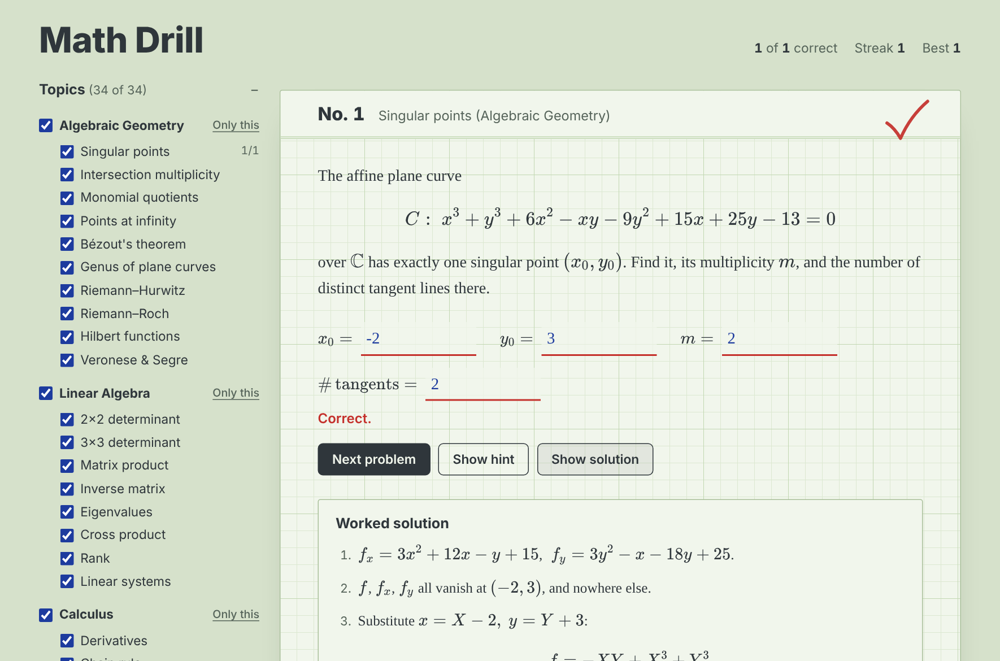

# Math Drill

Practice university math in your browser. Every problem is generated on the fly, so you never run out: type your answer, get it marked instantly, and read a worked, step-by-step solution.



## What you can practise

**Algebraic Geometry**: singular points (multiplicity and tangent cone), intersection multiplicities, dimensions of monomial quotients `k[x,y]/I`, points at infinity of projective closures, Bézout's theorem, genus of plane curves with nodes and cusps, Riemann–Hurwitz, Riemann–Roch, Hilbert functions, Veronese and Segre embeddings.

**Number Theory**: p-adic valuations and absolute values (Legendre's formula, Kummer's theorem), Legendre symbols by quadratic reciprocity, Hensel lifting of square and cube roots, points on elliptic curves over `F_p` and the trace `a_p` (Hasse's bound), point counts over `F_{p^2}` from the zeta function, splitting of primes in quadratic fields, Newton polygons.

**Linear Algebra**: 2×2 and 3×3 determinants, matrix products, inverse matrices, eigenvalues, cross products, rank, linear systems.

**Calculus**: derivatives, chain rule, definite integrals, limits (0/0 forms), partial derivatives, geometric series, Taylor series coefficients, 2nd-order linear ODEs, double integrals.

**Probability & Statistics**: combinations, drawing without replacement, expectation and variance, the binomial distribution, Bayes' theorem, mean and variance of data, continuous densities.

41 problem types in all. Tick the ones you want in the sidebar, or use *Only this* to focus on one topic.

## Features

- **Endless problems**: numbers are randomised, but always chosen so the answer is a clean integer or fraction.
- **Exact checking**: answers are compared as exact fractions. Type `3`, `-2/5` or `0.125`; for answers like 1/3, a decimal with at least three places (`0.333`) is accepted too. Full-width digits work.
- **Worked solutions** for every problem, plus a hint if you're stuck.
- **Why it matters**: each algebraic geometry problem ends with a short note on where the idea leads.
- **Further reading**: after each problem, books and lecture notes on that topic from the [Formosa public catalog](https://waterlily5297.github.io/MathKnowledge-Public/), with Japanese resources where the catalog has them. Titles open the source; *catalog entry* opens the book in the catalog, where a connected local library opens your own PDF.
- **Mistakes to revisit, spaced out**: anything you miss is saved so you can retry exactly the same problem. Each correct retry sends it further away (1, 3, 7, then 16 days); a wrong one starts it again from tomorrow, and five correct retries in a row retire it. *Retry N due* shows only what is due today.
- **Practise weak spots more**: an option that draws the types you get wrong, and the types you have not tried, more often (up to five times as often as a type you always get right).
- **Next step**: reveal the worked solution one step at a time to check your own next move. Only the last step, the answer, counts as a miss.
- **Progress**: problems answered per day over the last eight weeks, your day streak, and your weakest types (below 80%) with a button to practise just that type.
- **Review cards**: *Download as review cards (.md)* saves your mistakes as a Markdown note. Each problem is one card: the statement, a line holding only `?`, then the answer and worked solution, with math as `$...$`. It displays in Obsidian, and Formosa's card import (explicit card syntax in a saved note) reads each problem as one card, up to 200 per note. The note is made in your browser; nothing is uploaded.
- **Progress tracking**: score, streak and per-topic accuracy are saved in your browser.
- **Keyboard friendly**: press <kbd>Enter</kbd> to check, and <kbd>Enter</kbd> again for the next problem.
- Light and dark themes (follows your system setting), works on phones.

## Book exercises

`exercises.html` schedules exercises from the books you are reading, so you can practise on problems written by their authors instead of generated ones.

- **Add** a book (titles from the [Formosa catalog](https://waterlily5297.github.io/MathKnowledge-Public/) are suggested, and any other title works), an optional chapter or section, the exercise numbers (`3.17-3.20, 3.24`; a range keeps everything before its last number, as in `II.3-II.5`) and an optional page.
- **Solve** each due exercise on paper in the book, then mark *Solved it* or *Not yet*. Solved exercises come back after 1, 3, 7 and 16 days, and one more success marks them mastered; *Not yet* brings them back tomorrow. Answers count toward the activity calendar on the problems page.
- **Only references are stored** for your own books (book, section, number, page), so no problem text is copied. Books from the catalog link to their catalog entry, where a connected local library opens your own PDF.
- **Backup**: exercises live in this browser's storage. *Download backup* saves a JSON file; *Restore* merges one back without overwriting saved progress.

### Exercise decks from openly licensed books

*Restore* also loads a deck: exercises with their text and the book's own answer, from a book whose licence allows sharing them. A deck must name its source and licence, or it is refused:

```json
{
  "format": "math-drill-exercise-deck",
  "version": 1,
  "source": { "title": "…", "authors": "…", "license": "CC BY-SA 4.0", "url": "https://…" },
  "catalogId": "optional Formosa catalog ID",
  "exercises": [
    { "section": "One.I.1", "number": "1.17", "page": 12, "text": "Statement, with TeX in \\( \\)", "answer": "The book's answer" }
  ]
}
```

The text and answers must be taken from the book's own source files and published answers, with the licence checked at the source; no deck is bundled yet. The page shows the source and licence under each answer.

## Run it

No build step and no dependencies at runtime.

- **Locally**: download the repository and open `index.html` in your browser. (Math rendering uses KaTeX from a CDN, so you need an internet connection.)
- **On GitHub Pages**: in this repository go to *Settings → Pages*, set *Source* to *Deploy from a branch*, choose the branch this app is on (`math-drill`) and `/ (root)`, and save. The app will be live at `https://<your-username>.github.io/<repository-name>/` within a minute or two.

## Tests

The tests check every problem type over hundreds of random seeds against an independent calculation (numerical integration, brute-force probability, Gaussian elimination, exact polynomial gcds, brute-force monomial counts, point counts over an explicitly built `F_{p^2}`, a pointwise Newton polygon and so on), confirm that all generated math renders with KaTeX, and exercise the answer checker.

```bash
npm install
npm test
```

They also run automatically on GitHub Actions for every push. A second job downloads the published catalog and checks that every book in `js/reading.js` is still listed with the same title and link and that every catalog search still finds results. To run that check yourself, point `FORMOSA_CATALOG` at a copy of `catalog.json`:

```bash
FORMOSA_CATALOG=path/to/catalog.json node --test tests/reading.test.js
```

## Project structure

```
index.html          the page
css/style.css       styles (engineering-pad look, light and dark)
js/core.js          exact fractions, seeded random numbers, answer parsing, TeX helpers
js/problems.js      linear algebra, calculus and probability generators, plus the topic list
js/problems-ag.js   algebraic geometry generators
js/problems-nt.js   number theory generators
js/reading.js       further reading per problem type (books from the Formosa catalog)
js/cards.js         saved mistakes as a Markdown note of review cards
js/study.js         review schedule, weighted practice and the daily activity log
js/exercises.js     book exercises: number ranges, scheduling, backups and decks
js/exercises-app.js the book exercises page
exercises.html      the book exercises page
js/app.js           the interface: picking problems, checking, progress, review
tests/              Node tests (node:test)
```

## Adding a problem type

1. Write a generator in `js/problems.js` (or `js/problems-ag.js` for algebraic geometry, `js/problems-nt.js` for number theory). It receives a seeded random number generator and returns the statement, the answers (as `Fraction`s), a hint and solution steps. Keep a `data` field with the raw numbers.
2. Register it in the `TYPES` list with an id, topic and name.
3. Add its further reading to `READING` in `js/reading.js`: one or more catalog IDs and a catalog search.
4. Add a matching verifier in `tests/problems.test.js` (or `tests/ag-verifiers.js`, `tests/nt-verifiers.js`) that recomputes the answer from `data` a different way, then run `npm test`.

## License

MIT
